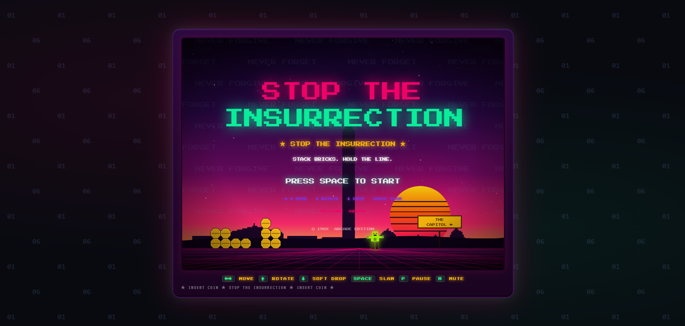
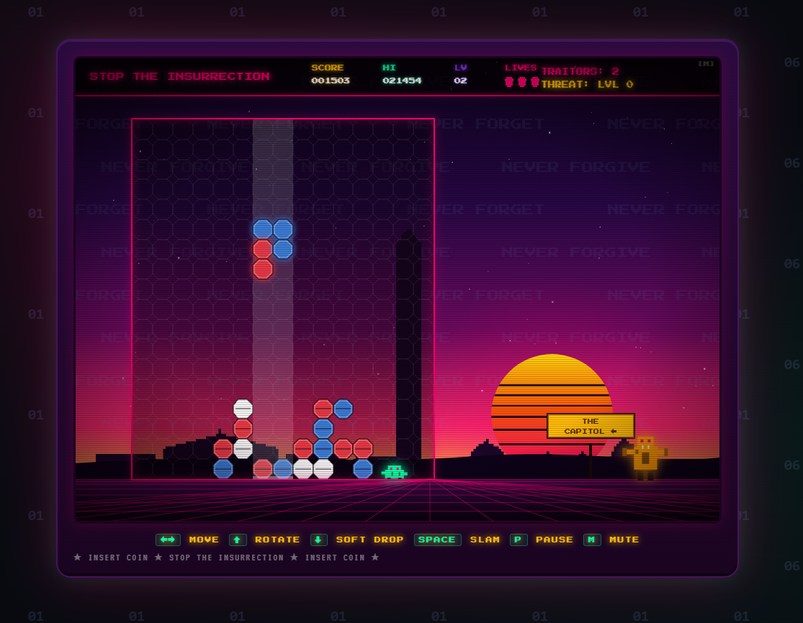
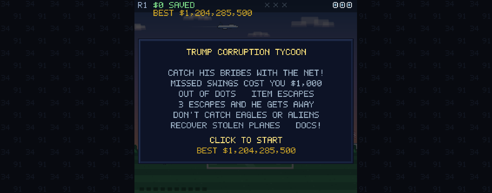
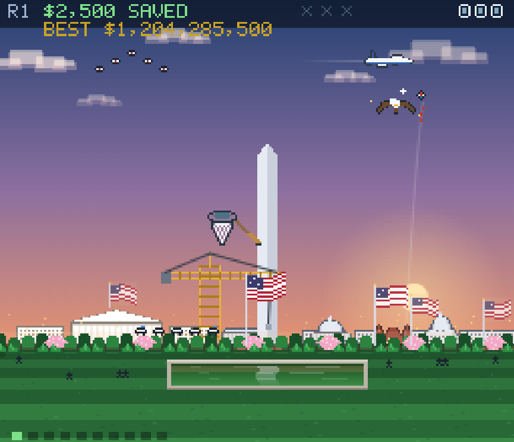

# whitehouse games

The White House put a set of shit propaganda games on arcade.gov. This repo has both: the originals, rebuilt and preserved, and anti-fascist remixes that flip each game's message around.

I'm not a game maker. But the bar the White House set is on the floor, and anything I make has to be better than the shit they made. That's the whole project: take their shit and make it less shit, and counter the message while I'm at it.

## wh-arcade/ — The Originals

Reverse-engineered and rebuilt copies of all six arcade.gov games (the sixth, Escape From Socialism, is a card-matching game that dresses up CEA talking points about "the socialist agenda" as facts you uncover), kept in their original state as documentation of what they shipped. See [wh-arcade/README.md](wh-arcade/README.md) for the capture details, verification notes, and rights (17 U.S.C. § 105 — no copyright in U.S. Government works, so it's free to mirror and mod).

## anti-fascist games/ — The Mods

The same games with the message flipped into protest games.

### Stop the Insurrection (mod of Build the Wall)

Defend the Capitol from a wave of insurrectionists instead of building the wall.

- Block-stacking defense built from the 12 classic pentominoes (F, I, L, N, P, T, U, V, W, X, Y, Z) on a 15-column board.
- Clear groups of 3+ matching colors instead of full lines.
- Traitors march along the bottom; when one dies on a column it eats your barricade from below, triggering cascades.
- The D.C. skyline backdrop is lifted straight from the Tycoon game (same skyline, same buildings).
- "NEVER FORGET / NEVER FORGIVE" scrolls across the sky, the HUD counts TRAITORS, and the page background is tiled with "01 06" — the date, not a version number.

### Trump Corruption Tycoon (mod of Trump Savings Tycoon)

Catch his bribes with a giant net before they escape. Missed swings cost $1,000, three escapes and he gets away. Extras: recover Air Force One and Marine One, dodge the alien penalty, catch the golden hamburger, and click the reflecting pool for a free joke (MAGA — Make Algae Great Again). All the specials live in one config table in the code.

### Perp Walk (mod of Rio Run)

Snake-style warrant service: round up the whole administration along the line — staffers, Vance, Miller, Noem, Hegseth, Patel, and Trump himself (the biggest fish). Noem chases a dog around the board while you play.

### Flappy Bill

Keep the bill in the air while flying through monuments.

### The Cost of Trump (mod of Escape From Socialism)

[Play the standalone game](anti-fascist%20games/standalone/socialism.html). Open the HTML file in a browser; no server or installation is needed.

All **23 matching pairs** mirror the original game's topics, pictures and three level groupings: **Your budget**, **Your future**, and **The bigger picture**. Every reveal shows the original CEA claim word for word, then answers it with a number from his actual record on the same topic.

The CEA scored the worst case for a "socialist agenda" that was never enacted. This mod plays by the same rules for policies that were: the top of each range, the longest horizon a source models, the peak year, and the hardest-hit households. Import taxes up 234%, $6.6 trillion wiped off stocks in two days, up to 16 million more uninsured, GDP 4.6% smaller by 2054. The framing is as harsh as theirs, but every number is real and links to its source (Tax Foundation, Yale Budget Lab, Penn Wharton, CBO via KFF, Energy Innovation, E2 and others). The receipts menu explains the method and flags the overlapping estimates that shouldn't be added together. Progress saves locally under a separate key, and the original game remains in `wh-arcade/`.

Run the remix checks with `node --test "anti-fascist games/tests/socialism.test.cjs"`.

### Supply Line

Food-safety conveyor satire: bare food rides, treated food comes off. You decide what stays on the line — let it ride, or knock it off.

## Development notes

- Each game lives in three forms: `games/` (as-shipped bundle), `readable/` (beautified source — this is the one to edit), and `standalone/` (self-contained playable HTML).
- There are no build scripts. Edits to `readable/*.js` must be mirrored into `standalone/*.html` by hand.
